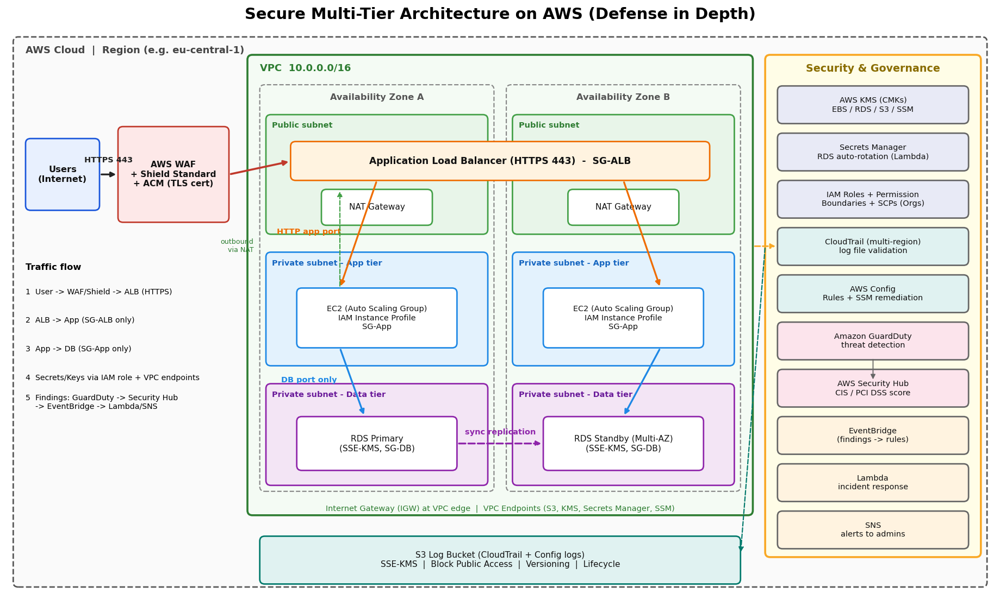

# Secure Multi-Tier Architecture on AWS

**Project:** AWS Certified Solutions Architect – Associate (SAA-C03) Graduation Project
**Selected idea:** Project 8 — Secure Multi-Tier Architecture with GuardDuty, KMS & Security Hub
**Status:** Architecture design and documentation.

## 1. Project Overview
A defense-in-depth design for a three-tier web application (web, app, data) on AWS. It separates the public entry point, the application layer and the database layer, and applies least privilege, encryption at rest and in transit, secret management with rotation, logging, threat detection, compliance checks and automated incident response. It maps to the Security domain of SAA-C03 and the Well-Architected Security Pillar.

## 2. Architecture Diagram

### Request flow
1. A user sends an HTTPS request. **AWS WAF** filters it (SQLi/XSS managed rules, rate limiting) and **Shield Standard** gives baseline DDoS protection. TLS certificate comes from **ACM**.
2. The **ALB** in the public subnets accepts HTTPS (443) and forwards to the app tier.
3. **EC2 instances in an Auto Scaling Group** (private subnets, two AZs) serve the application. Outbound internet goes through **NAT Gateways**.
4. The app connects to **RDS (Multi-AZ)** in private data subnets, only on the DB port and only from the app security group.
5. The app reads DB credentials from **Secrets Manager** using its **IAM role** (no hardcoded secrets). Data is encrypted with **KMS customer-managed keys**.
6. **CloudTrail** and **Config** write to an encrypted S3 log bucket. **GuardDuty** findings flow into **Security Hub**; **EventBridge** rules trigger **Lambda** (incident response) and **SNS** (alerts).

## 3. AWS Services and Roles
| Service | Role in the design |
|---|---|
| Amazon VPC, public/private subnets, IGW, NAT | Network isolation across 2 AZs; app and data layers have no public IPs |
| Security Groups | SG-ALB → SG-App → SG-DB chain (stateful, least privilege) |
| ALB + ACM | HTTPS entry point, TLS termination, routing |
| AWS WAF + Shield Standard | Edge protection against SQLi, XSS, and volumetric DDoS |
| EC2 + Auto Scaling | Application compute in private subnets (final choice depends on scope) |
| Amazon RDS (Multi-AZ) | Managed database in private subnets, encrypted with KMS |
| AWS KMS | Customer-managed keys for EBS, RDS, S3 and SSM Parameter Store |
| AWS Secrets Manager | Stores DB credentials; automatic rotation via Lambda rotation function; access is auditable |
| AWS IAM + SCPs | Least-privilege roles, permission boundaries, deny-root-usage SCP (requires AWS Organizations) |
| AWS CloudTrail | Multi-region trail with log file integrity validation, delivered to S3 |
| Amazon GuardDuty | Threat detection (Recon, Backdoor, CryptoCurrency findings) |
| AWS Security Hub | Aggregates findings; CIS AWS Foundations / PCI DSS standards and score (needs AWS Config enabled) |
| AWS Config | Tracks configuration, evaluates rules, remediates via SSM Automation documents |
| EventBridge + Lambda + SNS | Automated incident response and alerting on findings |
| Systems Manager Session Manager | Admin access to instances without bastion or open SSH |
| S3 log bucket | Central encrypted storage for CloudTrail/Config logs (Block Public Access, versioning, lifecycle) |

## 4. Security Design Decisions
- **Least privilege:** instance roles scoped to needed actions; permission boundaries limit delegated roles; MFA for administrators.
- **Private app and data layers:** no public IPs; admin access through Session Manager.
- **Restricted database access:** DB SG allows only the app SG on the engine port.
- **Encryption at rest:** KMS CMKs for EBS, RDS, S3 and SSM parameters; key policies restrict who can use/administer keys.
- **Encryption in transit:** HTTPS/TLS at the ALB; enforce TLS to RDS; VPC endpoints keep AWS API traffic off the internet.
- **Secrets:** no credentials in code or GitHub; Secrets Manager with automatic rotation.
- **Logging and detection:** CloudTrail (all regions, integrity validation), GuardDuty, Security Hub.
- **Compliance and remediation:** Config rules (e.g. encrypted volumes, public S3 buckets, restricted SSH) with SSM remediation documents, tested before enabling auto-remediation.
- **Incident response:** EventBridge rule on high-severity GuardDuty/Security Hub findings → Lambda (e.g. isolate instance by swapping to a quarantine SG) + SNS notification.

## 5. Network Access Policy
| Source | Destination | Access |
|---|---|---|
| Internet | ALB | HTTPS (TCP 443) |
| SG-ALB | SG-App | Application port only |
| SG-App | SG-DB | Database engine port only (e.g. 3306 / 5432) |
| Internet | Database | Denied |
| Administrator | Instances | Session Manager (no inbound ports), MFA + least privilege |

Never open 0.0.0.0/0 to database or administration ports.

## 6. High-Level Implementation Plan
1. Plan non-overlapping CIDRs; create VPC with public/private subnets in two AZs.
2. Create route tables, IGW and NAT Gateways (only required paths); add VPC endpoints.
3. Create security groups (SG-ALB, SG-App, SG-DB).
4. Create KMS CMKs and key policies.
5. Deploy RDS Multi-AZ (encrypted) in private subnets; store credentials in Secrets Manager and enable rotation.
6. Create IAM roles/permission boundaries; deploy ALB (ACM cert), WAF web ACL, and the ASG.
7. Enable CloudTrail (multi-region + validation), Config, GuardDuty, Security Hub (CIS/PCI standards).
8. Create EventBridge rules, Lambda responder and SNS topic.
9. Add Config rules and SSM remediation after testing; apply SCPs (e.g. deny root usage) if using Organizations.
10. Validate, document evidence and costs, then delete test resources.

## 7. Validation Checklist
- [ ] HTTPS access to the application works
- [ ] WAF blocks a test SQLi/XSS request
- [ ] Direct internet access to the database is blocked
- [ ] App-to-database works only via the intended SG rule
- [ ] EBS/RDS/S3 encryption verified with the CMK
- [ ] Secrets Manager rotation succeeds
- [ ] IAM permissions reviewed for least privilege
- [ ] No secrets committed to the repository
- [ ] CloudTrail events and log validation reviewed
- [ ] GuardDuty sample findings appear in Security Hub; Security Hub CIS score reviewed
- [ ] EventBridge → Lambda/SNS fires on a sample finding
- [ ] Config rules evaluate and remediation works
- [ ] Costs reviewed and temporary resources removed

## 8. Cost and Scope Notes
Charges may apply for NAT Gateways, ALB, EC2, RDS Multi-AZ, WAF, KMS keys, Secrets Manager, GuardDuty, Security Hub and Config. Pricing varies by region and usage; use the AWS Pricing Calculator and remove any temporary resources when finished.

## 9. References
- [Well-Architected Framework](https://docs.aws.amazon.com/wellarchitected/latest/framework/welcome.html)
- [Amazon VPC](https://docs.aws.amazon.com/vpc/latest/userguide/what-is-amazon-vpc.html)
- [AWS IAM](https://docs.aws.amazon.com/IAM/latest/UserGuide/introduction.html)
- [AWS KMS](https://docs.aws.amazon.com/kms/latest/developerguide/overview.html)
- [AWS Secrets Manager](https://docs.aws.amazon.com/secretsmanager/latest/userguide/intro.html)
- [Amazon GuardDuty](https://docs.aws.amazon.com/guardduty/latest/ug/what-is-guardduty.html)
- [AWS Security Hub](https://docs.aws.amazon.com/securityhub/latest/userguide/what-is-securityhub.html)
- [AWS CloudTrail](https://docs.aws.amazon.com/awscloudtrail/latest/userguide/cloudtrail-user-guide.html)
- [AWS Config](https://docs.aws.amazon.com/config/latest/developerguide/WhatIsConfig.html)
